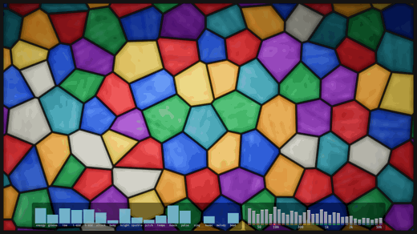

# synestesia

Synestesia listens to whatever is playing (the microphone, a
file, or the computer's own audio output) and makes it dance.

<table>
<tr>
<td width="50%"></td>
<td width="50%"></td>
</tr>
<tr>
<td><b>Bubbles</b>: shiny bubbles flow through wind, four vortices and turbulence, gather on the nodal lines of a vibrating plate, and hop on the beat.</td>
<td><b>Glass window</b>: a stained-glass window lit from behind. Its panes dance the salsa on the beat, ripple, breathe and shake when the band crashes in; a spotlight dances behind the glass while someone sings.</td>
</tr>
</table>

Three more scenes (`Tab` cycles through all five):

- **Pendulums** (dancing): twelve glowing pendulums in a row swing on the beat
  in changing figures: together, in a wave, mirrored, against each other. There
  is one per note, so the chord being played is the pendulums that shine.
- **Aurora** (following the music): northern lights over a treeline. The
  spectrum shapes the curtains along the horizon, the harmony colours them, and
  each chord change sends a wave of light across.
- **Ballroom** (dancing, inspired by a ballroom seen from above): 24 couples of
  glowing dancers turn a step on every beat and glide between figures: a
  promenade round the floor, rows stepping towards each other, two rings,
  a wheel, everyone wandering. Each couple dances a note, so the chord being
  played shines; a drop breaks the holds, and a singer sets a disco ball
  turning. They dance on water, in space, in the sky, on black or on a mirror
  (`G` switches, `--ground` picks).

## Platforms

|                                   | macOS                       | Linux                          | Windows        |
|-----------------------------------|-----------------------------|--------------------------------|----------------|
| Runs                              | yes (Apple silicon)         | yes                            | not tested     |
| Microphone, any input (`--device`)| yes                         | yes                            | not tested     |
| A music file (`--file`)           | yes                         | yes                            | not tested     |
| System audio loopback (`--system`)| yes, macOS 14.6 or later    | yes, with PulseAudio, PipeWire | no             |
| Singing / voice detection         | yes (the system's sound classifier) | no (reads as no voice) | no             |

## Building

You need Rust 1.97.1 or later (Bevy 0.20's minimum).

```bash
cargo run --release
```

## Running

```bash
cargo run --release                               # listen to the microphone
cargo run --release -- --file song.flac           # play a file and react to it
cargo run --release -- --system                   # react to what the computer plays
cargo run --release -- --file song.mp3 --scene glass --fullscreen
```

### Main options

| Option | What it does |
|---|---|
| `--file PATH` | Play a file through the speakers and react to it |
| `--mute` | With `--file`: react without playing it |
| `--system` | React to the computer's audio output |
| `--device NAME` | Use this input (part of its name); `--list-devices` lists them |
| `--synthetic` | A built-in 120 BPM test track instead of live audio |
| `--scene bubbles\|glass\|pendulums\|aurora\|ballroom` | Start in this scene (default: the last one shown) |
| `--fullscreen` | Start in borderless fullscreen |
| `--width N`, `--height N` | Window size (default 1920 × 1080) |
| `--spectrum` | Show the histogram |
| `--prefs` | Open the preferences panel |
| `--debug` | Show the debug overlay |
| `--no-prefs` | Ignore the saved preferences (and don't save) |
| `--bubbles N`, `--radius PX`, `--panes N` | Bubble count and size; panes in the window |

For studying what the music reads as: `--analyze FILE` (repeat it per file) runs a track through
the analysis and adds it to the timeline in `analysis/index.html` (`python3 tools/serve.py 8766 analysis`,
then open http://localhost:8766). `--scenarios` writes synthetic test music with a known answer
(chord progressions, a verse and chorus, a build-up and drop; see `src/scenarios.rs`) to
`scenarios/` and adds it to the same timeline, with what is really played written over the
tension lane.

For checking and recording: `--solo CONTROL` (one control on its own; `--solo list`), `--bench S`
(run S seconds and print the frame rate), `--screenshot PATH`, `--capture DIR`,
`--fixed-fps N`, `--novsync`, `--scale-factor F`.

### Keys

| Key | |
|---|---|
| `Tab` | Next scene |
| `G` | Ballroom: next ground (water, space, sky, black, mirror) |
| `Cmd-,` (`Ctrl-,`) | Preferences: every transformation and control, live |
| `H` | Histogram |
| `D` | Debug overlay: every signal, transformation and control |
| `F`, `Alt-Enter` | Fullscreen |
| `Q` | Quit |
| `M` | Source: live, synthetic, silent |
| `Space`, `B`, `1`–`4` | Fake an onset, a beat, a band (synthetic or silent source) |
| `Esc` | Close the preferences |

Preferences are saved when you let go of a slider, in
`~/Library/Application Support/synestesia/prefs.txt` on macOS and
`~/.config/synestesia/prefs.txt` on Linux.
